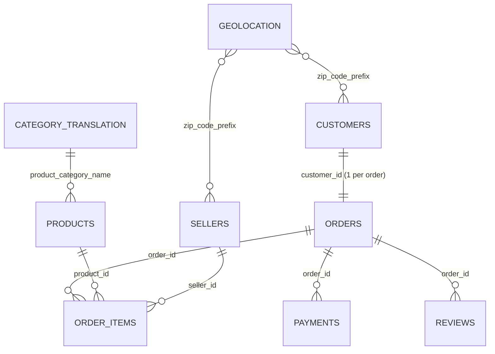

# Data sources: Olist Brazilian E-Commerce

Source: the [Olist public dataset on Kaggle](https://www.kaggle.com/datasets/olistbr/brazilian-ecommerce): 9 CSV files in `data/olist/` (not tracked in git).
Exploration: [`notebooks/olist_data_explorer.ipynb`](../notebooks/olist_data_explorer.ipynb).

Orders cover **Sep 2016 – Oct 2018**, but only **Jan 2017 – Aug 2018** has full volume (see [Orders](#orders)).

| Table | File | Rows | Grain | Key |
|---|---|---:|---|---|
| orders | `olist_orders_dataset.csv` | 99,441 | one order | `order_id` |
| order_items | `olist_order_items_dataset.csv` | 112,650 | one item (line) in an order | `order_id` + `order_item_id` |
| payments | `olist_order_payments_dataset.csv` | 103,886 | one payment of an order | `order_id` + `payment_sequential` |
| reviews | `olist_order_reviews_dataset.csv` | 99,224 | one review of an order | `review_id` + `order_id` |
| customers | `olist_customers_dataset.csv` | 99,441 | one customer-per-order | `customer_id` |
| products | `olist_products_dataset.csv` | 32,951 | one product | `product_id` |
| category_translation | `product_category_name_translation.csv` | 71 | one category | `product_category_name` |
| sellers | `olist_sellers_dataset.csv` | 3,095 | one seller | `seller_id` |
| geolocation | `olist_geolocation_dataset.csv` | 1,000,163 | one lat/lng point in a zip prefix | none |

## How the tables connect

- customers → orders: **one-to-one** on `customer_id`; **one-to-many** on `customer_unique_id` (the real person).
- orders → order_items, payments, reviews: **one-to-many**.
- products, sellers → order_items: **one-to-many**.
- geolocation ↔ customers, sellers: **many-to-many** on zip prefix, until geolocation is reduced to one row per prefix.

Every foreign key resolves: there are no orphan items, payments, reviews, products or sellers. In the other direction, some orders have no child rows: **775 orders have no items, 768 have no review, and 1 has no payment.**

Joining orders to order_items gives 112,650 rows (inner) or 113,425 rows (left, which adds the 775 orders without items). Any order-level amount summed after that join is double-counted.

All date columns in every file are stored as **text** and need casting.

---

## Orders

- **Grain:** one row per order.
- **Key:** `order_id` (unique).
- **Links:** `customer_id` → customers. `order_id` is used by order_items, payments and reviews.
- **Statuses:** delivered 96,478 (97.0%), shipped 1,107, canceled 625, unavailable 609, invoiced 314, processing 301, created 5, approved 2.
- **Timestamps:** purchase → approved → delivered to carrier → delivered to customer. `order_estimated_delivery_date` is set at purchase and has no time of day.
- **Missing values:** `order_approved_at` 160, `order_delivered_carrier_date` 1,783, `order_delivered_customer_date` 2,965. These mostly follow the status: orders that haven't reached a step yet have no timestamp for it.
- **Surprises:**
  - 1,359 orders were handed to the carrier **before** they were approved. The median gap is about 17 h; the largest is 171 days.
  - 23 orders were delivered to the customer **before** the carrier picked them up.
  - 8 `delivered` orders have no customer delivery date, 14 have no approval date, and 2 have no carrier date.
  - 6 `canceled` orders have a customer delivery date.
  - The start and end months are thin. Sep–Dec 2016 has 329 orders, with none at all in Nov 2016. Sep–Oct 2018 has 20 orders, and 19 of them are canceled.
  - Nov 2017 peaks at 7,544 orders (Black Friday).
  - 6,535 of 96,476 delivered orders (6.8%) arrived after the estimated date, comparing by date.

## Order items

- **Grain:** one row per item in an order. Buying 3 of the same product gives 3 rows; there is no quantity column.
- **Key:** `order_id` + `order_item_id`. `order_item_id` is a line number (1, 2, 3…) within the order.
- **Links:** `order_id` → orders, `product_id` → products, `seller_id` → sellers.
- **Missing values:** none.
- **Values:** `price` is the item price and `freight_value` is that item's shipping charge. The median price is R$75 and the median freight is R$16.
- **Surprises:**
  - 9.9% of orders have more than one item; the maximum is 21.
  - 383 items have zero freight, and 4,124 have freight higher than the price.
  - In 79% of multi-item orders, every item has the same freight value. Freight looks like it is split or repeated per item, so order freight = the **sum** across rows.

## Payments

- **Grain:** one row per payment of an order.
- **Key:** `order_id` + `payment_sequential`.
- **Links:** `order_id` → orders.
- **Missing values:** none.
- **Payment types:** credit_card 73.9%, boleto 19.0%, voucher 5.6%, debit_card 1.5%, not_defined 3 rows.
- **Several payments per order:** 2,961 orders have more than one, mostly because of **vouchers**: 90% of multi-payment orders include one. Installments do *not* add rows; they are stored in `payment_installments`.
- **Payments vs items:** for 99.7% of orders, the sum of `payment_value` equals sum(price + freight_value) to within one cent. 264 orders paid more and 39 paid less (between −R$52 and +R$183).
- **Surprises:**
  - 9 payments of R$0: 6 vouchers, plus the 3 `not_defined` rows.
  - 2 payments have `payment_installments = 0`.
  - 80 orders have gaps in `payment_sequential`.
  - 1 order has no payment at all.

## Reviews

- **Grain:** meant to be one review per order, but that doesn't hold.
- **Key:** `review_id` + `order_id`. `review_id` alone is **not** unique.
- **Links:** `order_id` → orders.
- **Missing values:** `review_comment_title` 88% and `review_comment_message` 59%. The score is mandatory; the text is optional.
- **Scores:** 5 = 57.8%, 4 = 19.3%, 3 = 8.2%, 2 = 3.2%, 1 = 11.5%. Customers mostly give 5 or 1.
- **Surprises:**
  - 547 orders have 2–3 reviews.
  - 789 `review_id`s are attached to more than one order, with identical content. This looks like one review being copied to every order of a combined purchase.
  - 768 orders have no review.

## Customers

- **Grain:** one row per `customer_id`, and a new `customer_id` is created **for every order**.
- **Key:** `customer_id`.
- **Links:** `customer_id` → orders (1:1). `customer_zip_code_prefix` → geolocation.
- **Missing values:** none.
- **Real person:** `customer_unique_id` (96,096 people vs 99,441 customer_ids).
- **Repeat buyers:** only 2,997 people (3.1%) placed more than one order; the most is 17.
- **Surprises:** `customer_id` is effectively an order-level key, so it can't be used as a person dimension key. 278 customer zip prefixes are missing from geolocation.

## Products

- **Grain:** one row per product.
- **Key:** `product_id`.
- **Links:** `product_id` → order_items. `product_category_name` (Portuguese) → category_translation.
- **Missing values:** 610 products have no category, and the same 610 also lack name length, description length and photo count. 2 products have no weight or dimensions.
- **English names:** left-join `category_translation` on `product_category_name`.
- **Surprises:**
  - Column names are misspelled in the source: `product_name_lenght`, `product_description_lenght`.
  - 2 categories have no translation: `pc_gamer` and `portateis_cozinha_e_preparadores_de_alimentos`.
  - 4 products weigh 0 g.
  - There is no product name, only its length.

## Category translation

- **Grain:** one row per category (71). **Key:** `product_category_name`.
- **Links:** → products.
- **Missing values:** none. **Surprises:** it is missing 2 categories that products uses (see above).

## Sellers

- **Grain:** one row per seller.
- **Key:** `seller_id`.
- **Links:** `seller_id` → order_items. `seller_zip_code_prefix` → geolocation.
- **Missing values:** none.
- **States:** SP has 1,849 sellers (60%), followed by PR 349, MG 244, SC 190 and RJ 171. Only 23 of the 27 states have sellers.
- **Surprises:** 7 seller zip prefixes are missing from geolocation.

## Geolocation

- **Grain:** one lat/lng point within a zip code prefix.
- **Key:** none. `geolocation_zip_code_prefix` is not unique: 19,015 prefixes across 1,000,163 rows, with up to 1,146 rows for one prefix.
- **Why:** the prefix is only the first 5 digits of the CEP, so it covers an area with many addresses, and each row is a different point.
- **Links:** zip prefix ↔ customers and sellers.
- **Missing values:** none.
- **Surprises:**
  - 261,831 rows are exact duplicates.
  - 8,556 prefixes have more than one spelling of the city (accents, case).
  - 42 points fall outside Brazil.
  - 278 customer prefixes and 7 seller prefixes have no geolocation row.

---

## Questions for the pipeline

Things to decide or handle when building the staging and mart models:

1. **Date range:** keep all orders in staging, but should reporting marts filter to Jan 2017 – Aug 2018, or should the thin months be flagged?
2. **Timestamp casting:** cast every text date column (orders, order_items, reviews) to timestamp in staging.
3. **Out-of-order timestamps:** flag carrier-before-approval (1,359) and customer-before-carrier (23) instead of dropping them? Add dbt tests that warn rather than fail?
4. **Status vs timestamps:** how should we treat `delivered` orders with no delivery date (8) and `canceled` orders that have one (6)?
5. **Late delivery:** define `is_late` by date (delivered date > estimated date) and document that choice.
6. **Customer dimension:** build `dim_customer` on `customer_unique_id`, and map `customer_id` → `customer_unique_id` in staging.
7. **Fact grain:** `fct_order_items` at item grain (`order_id`, `order_item_id`) and/or `fct_orders` at order grain. Avoid summing payments after joining to items.
8. **Payments:** aggregate to one row per order before joining. Decide how to treat the ~300 orders where payments ≠ items + freight, the R$0 and `not_defined` payments, and the order with no payment.
9. **Reviews:** dedupe to one review per order (latest `review_answer_timestamp`?). A `review_id` shared across orders is fine at order grain but can't be the key.
10. **Product categories:** fill in English names for the 2 untranslated categories, and use `unknown` for the 610 products with no category.
11. **Column names:** rename `*_lenght` → `*_length` in staging.
12. **Geolocation:** reduce to one row per zip prefix (median lat/lng, most common city/state), drop points outside Brazil, and accept that ~285 zips will have no coordinates.
13. **Orders without items** (775, mostly unavailable/canceled): keep them in `fct_orders` with zero revenue, or exclude them?
14. **Seller-level analysis:** an order can have items from several sellers, so seller metrics must be computed at item grain.
